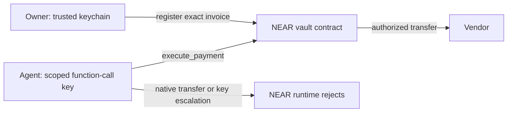

# IntentGuard

**IntentGuard gives a payment agent permission to execute one exact invoice.** The owner registers the recipient, amount and expiry on NEAR. The agent holds a function-call key scoped to `execute_payment`; the vault contract checks the stored authorization and spending limits before releasing funds.

Built for the **NEAR Hackathon — AI Security & Defense** track.

## Open the public demo

[Explore the attack console](https://code-kaybee.github.io/Intent-Guard/).

The public interface replays **22 verified cases captured from a real NEAR Sandbox**: 19 blocked attacks, the unrestricted control, an approved invoice payment, and failed-transfer recovery. Search cases, compare the three-step demo, inspect original receipts and balance checks, and download the complete evidence. The page clearly labels recorded results; exploring a case sends no new transaction.

The interface supports phones, tablets, and desktops, dark and light themes, keyboard navigation, and explicit loading and retry states. [Web build and GitHub Pages deployment](docs/WEB.md).

## Try the complete moment

Requires Node.js 20.15+ and Rust through [rustup](https://rustup.rs/). The repository pins Rust 1.85 and the WASM target. The local sandbox supports Linux x86-64 and macOS ARM64. The first install downloads the official NEAR Sandbox binary; subsequent runs use the cache.

```sh
npm ci
npm run build:contract
npm start
```

Open [http://localhost:4173](http://localhost:4173), wait for **LOCAL NEAR ONLINE**, and click **Run attack demo**. It submits three real requests to a local NEAR node:

1. **Without IntentGuard:** the unrestricted control wallet pays 0.08 NEAR to the attacker.
2. **Recipient substitution:** the scoped agent key submits a changed recipient. The contract rejects it; the attacker receives 0 NEAR.
3. **Approved invoice:** the vendor receives exactly 0.08 NEAR, and the invoice becomes `paid`.

Select **Skip the firewall** and submit it to see a raw native transfer rejected by NEAR's access-key validation. This refusal happens before transaction inclusion, so it correctly has no on-chain receipt. Contract refusals have transaction hashes and receipt errors. The dashboard shows actual key permissions, recipient balance changes and logs.

The server binds to loopback and runs an isolated, funded **NEAR Sandbox**, not public testnet. Its owner prepares deterministic invoices as demo setup. It requires no wallet, AI API key or real funds. Instruction fixtures are deterministic; transaction execution and decisions come from NEAR.

## Reproduce the proof

```sh
npm test
npm run test:integration
npm run benchmark
```

The integration suite checks 22 complete scenarios plus settlement recovery, immutable invoice IDs and one-yoctoNEAR amount tampering. The amount unit tests reject rounded numbers, exponent notation and values outside `u128`.

The benchmark writes `artifacts/attack-report.json`: 19 adversarial requests, one unrestricted control, one legitimate payment and one failed-transfer recovery. It checks specific rejection reasons, the enforcement layer, recipient balances, daily accounting and key counts. It exits nonzero if a check fails. **Run all 22 cases** in the local dashboard executes the same scenarios and offers a JSON download.

These are finite deterministic behavior tests. They demonstrate enforcement under malicious agent tool arguments; they do not measure an LLM's susceptibility to prompt injection or establish a general attack-prevention rate.

The frontend checks cover exact evidence replay, report integrity, desktop and mobile interactions, interrupted requests, retry behavior, and layouts from 320 to 1920 pixels:

```sh
npm run build:web
npm run test:web
```

## Why this boundary holds

- **Independent authorization:** invoice details come from owner-signed contract state. Rewriting `expectedReceiver`, `expectedAmount` or `spentToday` in the agent request changes no authority.
- **Protocol restrictions:** the agent key permits only `execute_payment` on the vault, with a finite 0.25 NEAR gas allowance. It cannot transfer native NEAR, attach a deposit, add a key, call another contract or change policy.
- **Contract enforcement:** the registered public key, exact recipient and integer amount must match. Expired, revoked, pending, paid and failed invoices cannot execute.
- **Budget reservation:** the UTC daily total is updated before the asynchronous transfer. Successful payments consume it; a failed transfer releases its reservation and closes the invoice.
- **Live controls:** owner policy changes apply to earlier approvals. The owner can pause the vault, revoke invoices and revoke the agent's contract authority.



## Public testnet

[Testnet setup and verification](docs/TESTNET.md) uses the owner's existing NEAR CLI keychain without exporting its key. It creates a funded vault and a separate restricted agent key, then demonstrates recipient substitution, direct-transfer bypass, a successful invoice payment and replay rejection.

```sh
npm run prepare:testnet
npm run deploy:testnet
npm run demo:testnet
```

Inspect the generated public deployment plan before running deployment. These commands sign transactions and use testnet NEAR. The local dashboard continues to use Sandbox; the public receipts are a separate evidence bundle.

## Trust and limits

This is a hackathon prototype for native NEAR invoice payments, not an audited custody product. The owner, deployment/admin keys, host and NEAR execution environment are trusted. Protecting the host or owner from compromise is outside the demonstrated threat model. The local harness owns its bootstrap accounts; a production integration must isolate owner credentials from the agent process.

Gas fees are separate from the invoice budget. A malicious agent can consume its finite gas allowance; retaining a trusted full-access recovery key lets the owner revoke or replace it. Invoice authorization cannot prevent an owner from approving a fraudulent invoice. There are no live reputation, account-age, scam-list, TEE or cross-chain claims.

Sandbox has privileged development APIs. The suite tests ordinary signed transaction submission and trusts the local node; public testnet evidence exercises the network's ordinary RPC. Public verification checks the deployed code hash, authorization, key scope and included receipt outcomes.

The SDK dependency tree retains low-severity advisories involving its optional secp256k1/elliptic path. This project uses ed25519 keys. The sandbox archive dependency is pinned to patched `tar` 7.5.23; do not describe the dependency audit as completely clean.

## Project layout

```text
contract/        Owner-authorized invoice vault (Rust / near-sdk)
lib/agent.mjs    Raw signed transaction submission with an isolated key store
lib/sandbox.mjs  Funded local chain, scenarios and balance verification
lib/testnet.mjs  Public RPC, local role credentials and owner CLI operations
server/         Loopback demo server; serves only UI assets and public evidence
src/            Attack console, exact amounts and scenario descriptions
integration/    Tests against real NEAR WASM execution and key validation
scripts/        Contract build, benchmark, testnet deployment and verification
docs/           Build decision, testnet workflow and submission materials
```

## Build and credits

The original browser simulation and visual design were created for this hackathon. The enforcement boundary was rebuilt during the November 2026 event: a NEAR contract, scoped-key executor, adversarial suite and live chain console replace the simulated gate.

Libraries: near-sdk 5.17.2, near-api-js 5.1.0, near-workspaces 5.0.0 and Binaryen 132.0.0. The build pins compatible system bindings and normalizes compiler output to NEAR's WASM baseline; use `npm run build:contract` rather than deploying raw compiler output.

Track: **AI Security & Defense (`security`)**. [Current hackathon rules](https://nearhackathon.com/HACKATHON.md). [Build decision and timebox](docs/BUILD_PLAN.md). [Demo and submission checklist](docs/SUBMISSION.md).
